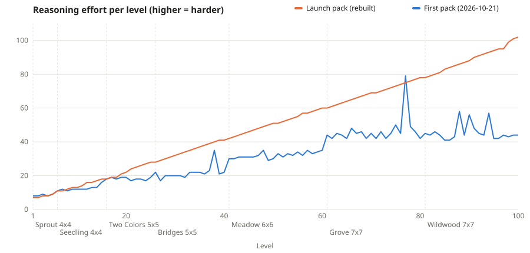

# Difficulty audit (2026-10-22)

How hard each level is to solve by reasoning, measured by a program instead of guessed from grid
size. Tools: `tools/level-analyzer/analyze.py` (measurement), `tools/level-analyzer/chart.py`
(chart), `tools/level-generator/build_campaign.py` (selection). Data: `levels.csv` (current pack),
`levels_before.csv` (the first pack of 2026-10-21). Chart: `effort.svg`.



## How difficulty is measured

A logic engine solves each level the way a careful person would, always using the weakest
technique that still makes progress:

| Technique | What the player has to see | Weight |
|-----------|----------------------------|--------|
| T1 local fit | An arm cannot point off the board, into a rock, or at a neighbour that can never connect back. Applied in rounds; each round uses only what earlier rounds settled. | 1 per tile settled |
| T2 network rule | An orientation would at once join two sources, feed a flower the wrong colour, or close a network with no source. | 3 per orientation ruled out |
| T3 what-if | "If this tile pointed here, then ... contradiction." One assumption followed by T1/T2 to a standstill. | 8 per orientation ruled out |
| T4 deep what-if | The contradiction only shows after a second, nested assumption. | 30 |
| Guess | Nothing above works; trial and error. | 80 |
| Extra round | Each round of deduction after the first (a longer chain of reasoning to hold in mind). | 2 per round |

**Effort** is the weighted sum. It mixes amount of work (tiles to settle) with depth of reasoning
(rounds, what-ifs). The weights are a model, not player data; real players will calibrate them
once playtesting or analytics exist. Every number per level is in the CSV, so the conclusion does
not rest on the weights alone.

Other measurements per level: grid size, rotatable tiles, pinned tiles, colours, bridges,
minimum taps (`min_moves`), raw search space in bits, independent solver nodes, deduction depth
(rounds), and the share of tiles that can be settled immediately ("entry share").

## What the first pack looked like

* 95 of 100 levels were solved by T1 alone. Only levels 38, 77, 88, 90 and 94 needed a what-if.
* Reasoning depth stayed at 2 to 7 rounds almost everywhere.
* Levels 81 to 100 (Wildwood, four colours) averaged effort 45.8, **lower** than levels 61 to 80
  (46.5). The extra colour did not make them harder to reason about.
* 34 places where a level was easier than the one before; 11 of those drops were more than 3 points.
* Within the 7x7 levels, effort tracked what-ifs (r = 0.95) and depth (0.92), not tile count
  (r = -0.07), and almost no 7x7 level needed a what-if. So the climb from level 1 to 100 really was
  mostly "the board gets bigger".

## What changed

`build_campaign.py` generated about 26,000 distinct candidates from the curriculum bands
(`games/circuit-garden/puzzles/curriculum.json`, two generator variants per band; fewer coloured
flowers and more blank ends make T1 stall more often), measured each one, and picked levels whose
effort climbs evenly through each band's range and never falls below the previous level. Levels of
the first pack were preferred when they fit: 13 were kept (in Sprout, Seedling, Two Colors and
Bridges). Every chosen level is re-proven unique by the independent validator and reproduces from
its recorded seed and generator params (tested for all 100).

## Result

| Levels | Size | Avg free tiles | Avg depth (rounds) | Avg what-if eliminations | Effort range |
|--------|------|----------------|--------------------|--------------------------|--------------|
| 1-15   | 4x4  | 9.1  | 2.5  | 0.0 | 7-18 |
| 16-40  | 5x5  | 17.6 | 5.6  | 0.5 | 18-41 |
| 41-60  | 6x6  | 26.9 | 9.1  | 1.1 | 42-60 |
| 61-80  | 7x7  | 40.5 | 11.1 | 1.2 | 60-78 |
| 81-100 | 7x7  | 38.7 | 15.8 | 2.9 | 78-102 |

* Effort never drops: 0 dips (was 34). Rank correlation with level number 1.00 (was 0.935).
* 72 levels need at least one what-if (was 5). Deepest chain 22 rounds (was 11).
* **The last 40 levels are all 7x7, and the hardest ones have fewer free tiles than the levels
  before them.** Inside the 7x7 levels, effort goes down as tile count goes up (r = -0.61) and
  rises with depth (0.84) and what-ifs (0.89). Their difficulty comes from reasoning, not size.
* Minimum taps does not drive difficulty either (r = -0.19 within 7x7).
* Effort beyond plain tile count averages 50.5 in levels 81 to 100, up from 9.9.

Labels come from effort: Easy < 20, Medium 20-44, Hard 45-74, Expert 75+. The pack has
18 Easy, 25 Medium, 33 Hard and 24 Expert levels, shown in the level title and level select.

## Limits

* No human has played the new curve yet. The weights are a reasoned model, so treat the labels as
  a first estimate and recheck with playtest times or (consented) completion data.
* The engine models logical deduction. It does not model visual difficulty (spotting a pattern on
  a busy 7x7 board), which probably adds difficulty to big boards on top of these numbers.
* T2 never fired on its own in this rule set: whenever a network rule mattered, it showed up inside
  a what-if. Kept in the engine because it is cheap and matters for future rule variants.

## Reproduce

```
python3 tools/level-analyzer/analyze.py games/circuit-garden/puzzles/levels_v1.json --csv docs/difficulty/levels.csv --json after.json
python3 tools/level-analyzer/analyze.py tools/level-generator/archive/levels_v1_2026-10-21.json --json before.json
python3 tools/level-analyzer/chart.py after.json before.json -o docs/difficulty/effort.svg
tools/level-generator/generate.sh   # rebuild the pack (about 2 minutes on 4 cores)
```
